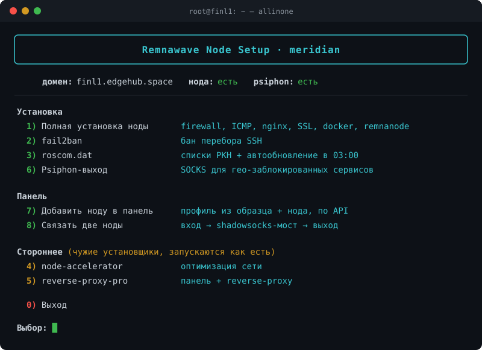
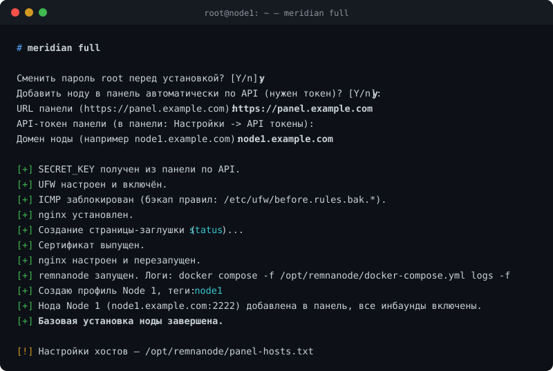
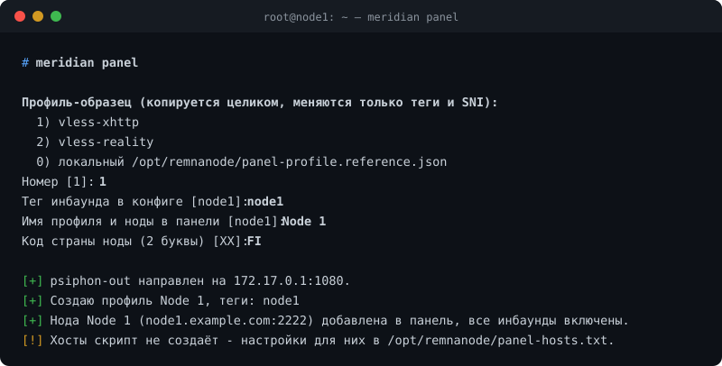
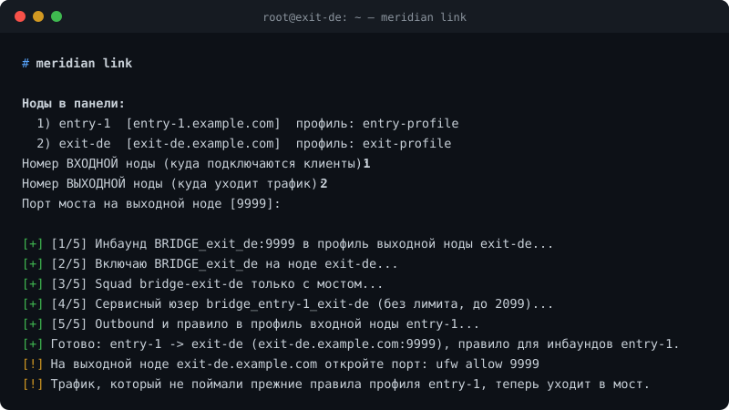
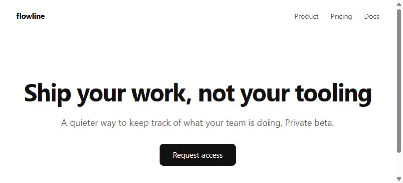
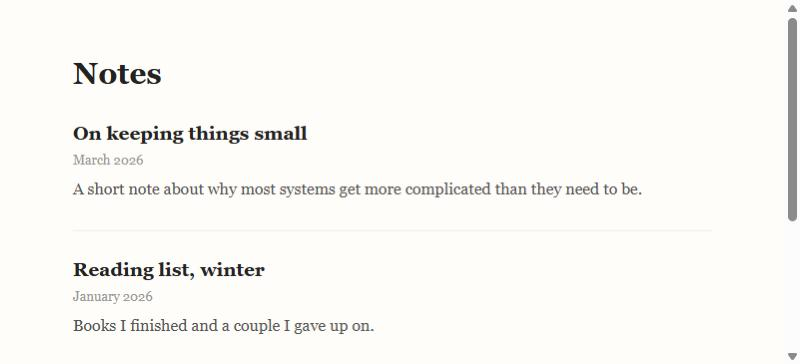
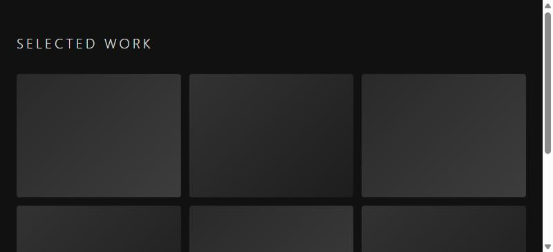
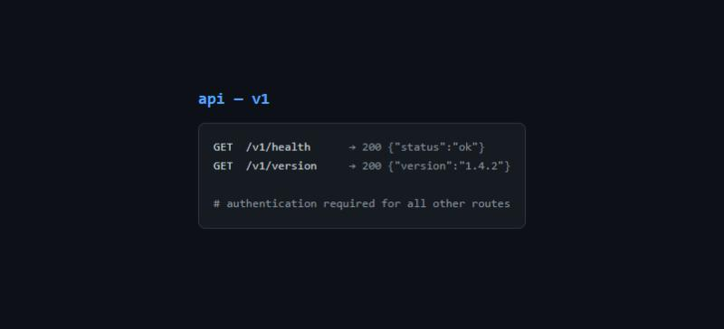
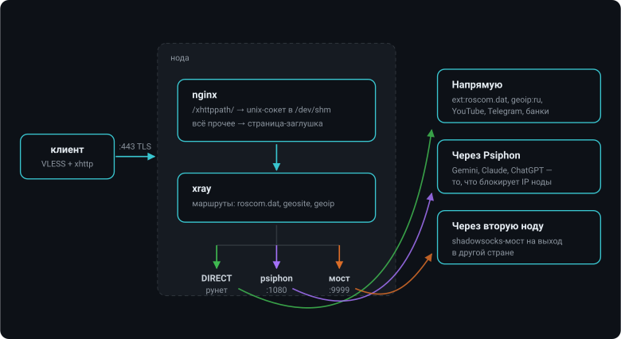

<div align="center">

# 🌐 meridian

**Нода Remnawave под ключ — одной командой.**

Firewall · ICMP · nginx + SSL · Docker · remnanode · fail2ban · roscom.dat
Psiphon-выход · добавление ноды в панель по API · связка нод через shadowsocks-мост

[](https://github.com/juhnsooqa/meridian/stargazers)
[](https://github.com/juhnsooqa/meridian/commits/main)




</div>

Собран из [remnawave-guide](https://github.com/herbalsomml/remnawave-guide) и части скриптов этого репозитория.

## 🚀 Запуск с сервера одной командой

```bash
sudo bash -c "$(curl -fsSL https://raw.githubusercontent.com/juhnsooqa/meridian/main/meridian.sh)"
```

Откроется интерактивное меню. Либо сразу конкретный шаг:

```bash
sudo bash -c "$(curl -fsSL https://raw.githubusercontent.com/juhnsooqa/meridian/main/meridian.sh)" -- full
```

<div align="center">

</div>

Доступные аргументы: `full`, `fail2ban`, `roscom`, `psiphon`, `panel`, `link`, `stub`, `ipv6`, `tune`, `accelerator`, `reverse-proxy`.

После первого запуска на сервере появляется команда `meridian` — открывает то же меню (каждый раз с последней версией скрипта с GitHub):

```bash
meridian            # меню
meridian psiphon    # сразу меню Psiphon
```

## 🎛 Добавление ноды в панель (одна кнопка)

`full` в начале спрашивает URL панели и API-токен (панель → Настройки → API токены) и дальше делает всё сам:

1. **вход в панель — до установки**: URL и токен проверяются сразу запросом к API, а не в конце, когда нода уже поднята;
2. берёт `SECRET_KEY` ноды из панели (`GET /api/keygen`) — с панелью его не спрашивают вовсе; вручную он вводится только если панель не подключали;
3. ставит ноду (смена пароля root, отключение IPv6, firewall, nginx, SSL, docker, remnanode);
4. копирует профиль-образец: выбираете любой существующий профиль, скрипт меняет в нём только **тег инбаунда** (`vless-xhttp` → `node1`, `EU_NODE_TCP` → `node1_TCP`), **SNI Reality** (если он есть) и адрес **psiphon-out** на локальный; dns, sockopt, маршруты и всё остальное копируются как есть;
5. создаёт ноду в панели с этим профилем и всеми его инбаундами.

<div align="center">

</div>

Отдельно то же самое: пункт меню **8** или `meridian panel`. Токен и URL хранятся в `/root/.remnawave-panel.env` (chmod 600).

Скрипт спрашивает два имени: **тег инбаунда** в конфиге (по умолчанию первая часть домена: `node1.example.com` → `node1`) и **имя профиля и ноды** в панели (по умолчанию — тот же тег, можно задать человеческое, например `Node 1`).

Если образец ссылается на то, чего на новой ноде ещё нет, скрипт это замечает и предлагает доставить:
`psiphon-out` в outbounds → установка Psiphon, `ext:roscom.dat:*` в маршрутах → настройка roscom.dat (без него xray просто не стартует).
Образцом может быть и локальный `panel-profile.reference.json`, но Reality-ключи в нём — заглушки, их придётся вписать в панели.
Хосты скрипт не создаёт — см. ниже.

## 🧩 Настройка хостов в панели

По мотивам [remnawave-guide](https://github.com/herbalsomml/remnawave-guide#настройки-tcp-хоста) (там же скриншоты).
Скрипт печатает эти же настройки с вашим доменом и сохраняет их в `/opt/remnanode/panel-hosts.txt`.
Профиль с инбаундами — `/opt/remnanode/panel-profile.reference.json`.

В панели: **Хосты → Создать**, для каждого хоста выбрать свой инбаунд и ноду, `<ДОМЕН>` — домен ноды.

**Основные**

| Хост | Инбаунд | Адрес | Порт |
|---|---|---|---|
| TCP | `NODE_TCP` | `<ДОМЕН>` | `44443` |
| XHTTP | `NODE_XHTTP` | `<ДОМЕН>` | `443` |
| gRPC | `NODE_GRPC` | `<ДОМЕН>` | `44444` |

**Расширенные**

| Поле | TCP и gRPC | XHTTP |
|---|---|---|
| SNI | `<ДОМЕН>` | `<ДОМЕН>` |
| Переопределить SNI из адреса | вкл | **выкл** |
| Хост | — | `<ДОМЕН>` |
| Путь | — | `/xhttppath/` (со слешем на конце, как на ноде) |
| Security Layer | по умолчанию | TLS |
| ALPN | — | `h2,http/1.1` |
| Отпечаток | — | `chrome` |

Для XHTTP ещё: **Xray Json & Raw → xHTTP** — вставить `/opt/remnanode/panel-xhttp-host-extra.reference.json`.

## 🌉 Связка нод и балансер

Скрипт кладёт в `/opt/remnanode/` готовые куски для вставки в панель. Автоматизации пока нет — всё руками в UI.

**Связка нод** ([server-routing](https://docs.rw/learn/server-routing)): вход RU → выход за границей через Shadowsocks-мост.
Ноды уже заведены в панели, связываются их существующие профили.

Автоматически — пункт меню **9** или `meridian link`. Выбираете входную и выходную ноду из списка панели, дальше скрипт сам:

1. дописывает инбаунд-мост `BRIDGE_<нода>` (shadowsocks, порт 9999) в профиль **выходной** ноды;
2. включает этот инбаунд на самой ноде;
3. создаёт internal squad только с этим инбаундом;
4. создаёт сервисного юзера (без лимита, до 2099, в этом скваде) со сгенерированным SS-паролем;
5. дописывает в профиль **входной** ноды outbound `SS_OUTBOUND_TO_EXIT` с этим паролем и правило `inboundTag: [её инбаунды] → мост`.

Правило ставится **в конец** `routing.rules`: сначала отрабатывают уже существующие правила профиля (категории из `roscom.dat`, `psiphon-out` и прочее), а в мост уходит только то, что они не поймали. Повторный запуск на той же паре не плодит дубли — инбаунд, outbound и правило заменяются по тегу.
Порт на выходной ноде скрипт откроет сам, если запущен на ней; иначе напомнит `ufw allow 9999`.

<div align="center">

</div>

Руками то же самое — готовые куски для вставки:

| Файл | Куда дописать |
|---|---|
| `panel-bridge-inbound.reference.json` | в `inbounds` профиля **выходной** ноды: SS-инбаунд `BRIDGE_IN` на порту 9999 |
| `panel-entry-routing.reference.json` | в профиль **входной** ноды: `outbound` → в её `outbounds`, `rules` → в начало её `routing.rules` |

Порядок тот же, что у пункта 8, только руками: инбаунд-мост → включить его на ноде → squad → юзер `bridge_user_001` → его **SS Password** (Users → More Actions → Detailed Info) в `password` у входной ноды → там же адрес выходной ноды и свой тег инбаунда в последнем правиле.

**Балансер** ([xray-json-advanced](https://docs.rw/learn/xray-json-advanced)) — это клиентский конфиг, а не нода: `panel-balancer-template.reference.json` вставляется в **Advanced → Xray JSON template** виртуального хоста. Балансируемые хосты надо скрыть (Hidden) и подставить их UUID в `injectHosts.selector.values`. Блок `remnawave` панель вырежет сама, подставив вместо него outbound'ы `proxy`, `proxy-2`, … — под них уже настроены `balancers.selector` и `burstObservatory.subjectSelector`. Нужна панель 2.6.3+.

## 🧱 IPv6

На многих VPS IPv6-адрес выдан, а маршрута наружу нет: docker и curl уходят в него и висят до таймаута — именно так выглядит «образ не качается, хотя сеть есть».
Отключается при установке (вопрос в `full`), отдельно — пункт меню **6** или `meridian ipv6`.

Перед отключением скрипт проверяет две вещи, которые иначе отрежут доступ:

- **твой SSH** — если ты зашёл по IPv6, отключение оборвёт сессию, поэтому скрипт откажется и попросит зайти по IPv4;
- **AAAA-запись домена** — если она есть, клиенты с IPv6 пойдут на неё и упрутся в тишину, а certbot не пройдёт проверку; скрипт предупредит и спросит подтверждение.

Пишется в `/etc/sysctl.d/99-meridian-no-ipv6.conf`, `lo` не трогается. Вернуть обратно:

```bash
rm /etc/sysctl.d/99-meridian-no-ipv6.conf && sysctl --system
```

## 🚀 Тюнинг сети

Против «TikTok/Instagram грузятся рывками». Применяется в конце `full`, отдельно — пункт меню **7** или `meridian tune` (можно запускать повторно).

- **Ядро** (`/etc/sysctl.d/99-zz-meridian-net.conf`): BBR + fq вместо cubic, TCP-буферы до 16 МБ под канал РФ↔Европа, без сброса скорости после паузы между роликами, MTU probing, RACK и терпимость к reordering, ECN выключен (DPI портит биты), быстрые таймауты мёртвых сокетов, conntrack на 262k с таймаутом 2 ч (иначе таблица забивается и новые соединения молча дропаются).
- **nginx**: 16384 соединений на воркер вместо 1024, xhttp без буферизации (`proxy_buffering off`, `proxy_request_buffering off`) и с часовыми таймаутами — поток не копится в nginx и не рвётся через 60 секунд.

Перед правкой nginx делается бэкап (`*.bak.<время>`); если `nginx -t` не проходит, бэкап возвращается сам. Файл назван `99-zz-…`, чтобы применяться последним и не перебиваться node-accelerator и другими `99-*`. Откатить ядро: `rm /etc/sysctl.d/99-zz-meridian-net.conf` и перезагрузка.

## 🎭 Заглушка

Кто придёт на `https://домен` без нужного пути, увидит обычный сайт. Одна и та же страница на всех нодах — сама по себе примета, поэтому вариантов 20, лежат в [stubs/](stubs/):

| | | | |
|---|---|---|---|
| `nginx` — дефолт nginx | `apache` — It works! | `blank` — пустая | `404` — Not Found |
| `parked` — домен припаркован | `coming-soon` — тёмная | `maintenance` — техработы | `construction` — ретро |
| `status` — всё работает | `api` — описание API | `docs` — документация | `personal` — страница разработчика |
| `blog` — заметки | `portfolio` — тёмная сетка | `saas` — лендинг сервиса | `startup` — форма подписки |
| `agency` — дизайн-студия | `shop` — магазин | `cafe` — кафе с меню | `all-good` — как было раньше |

Выбор при установке, потом в любой момент — пункт меню **5** или `meridian stub`, можно сразу номером: `meridian stub 13`. Вариант `0` — случайный.
Все страницы автономные: inline-CSS, ни одного внешнего запроса, ни одного чужого бренда — иначе заглушка сама себя выдаёт.

<table>
<tr>
<td width="50%"><br><sub align="center"><code>saas</code> — лендинг сервиса</sub></td>
<td width="50%"><br><sub><code>blog</code> — личные заметки</sub></td>
</tr>
<tr>
<td><br><sub><code>portfolio</code> — тёмная сетка работ</sub></td>
<td><br><sub><code>api</code> — описание эндпоинтов</sub></td>
</tr>
</table>

## 🛰 Psiphon

Пункт меню **4** ставит Psiphon как SOCKS-выход для xray ([psiphon/psiphon_install.sh](psiphon/psiphon_install.sh), копия [Chara-Freedom/vps-psiphon](https://github.com/Chara-Freedom/vps-psiphon), MIT).
Ставить только на зарубежную ноду. После установки в `/opt/remnanode/panel-profile.reference.json` добавляется аутбаунд `psiphon-out` и правило для `geosite:openai`/`geosite:google-gemini` (только TCP).
Управление — через меню или напрямую `vps-psiphon {status|rotate|region CC|speed|logs|uninstall}`.

## 🧭 Как ходит трафик

<div align="center">

</div>

Снаружи нода выглядит обычным сайтом: кто придёт на `https://домен` без нужного пути, увидит страницу-заглушку.

## 📂 Что где лежит на сервере

| Путь | Что это |
|---|---|
| `/opt/remnanode/` | нода: `docker-compose.yml`, `.env` (chmod 600), geo-файлы, справочные JSON для панели |
| `/root/.remnanode-setup.env` | домен, email, `SECRET_KEY`, порт ноды (chmod 600) |
| `/root/.remnawave-panel.env` | URL панели и API-токен (chmod 600) |
| `/etc/nginx/conf.d/xray.conf` | 443 и 9443 с SSL, `/xhttppath/` в сокет xray |
| `/etc/letsencrypt/live/<домен>/` | сертификаты, обновляет `certbot.timer` |
| `/etc/default/vps-psiphon` | параметры Psiphon, оттуда берётся адрес `psiphon-out` |
| `/usr/local/bin/meridian` | команда-обёртка, тянет свежий скрипт с GitHub |
| `/var/log/roscom_update.log` | лог ночного обновления roscom.dat |

## 🙏 Благодарности

| Проект | Что взято |
|---|---|
| [herbalsomml/remnawave-guide](https://github.com/herbalsomml/remnawave-guide) | порядок установки ноды, конфиг nginx, профиль и настройки хостов |
| [Chara-Freedom/vps-psiphon](https://github.com/Chara-Freedom/vps-psiphon) | установщик Psiphon целиком (MIT, лежит в `psiphon/`) |
| [hydraponique/roscomvpn-geosite](https://github.com/hydraponique/roscomvpn-geosite) | geosite от roscomvpn — ставится как `roscom.dat` |
| [Loyalsoldier/v2ray-rules-dat](https://github.com/Loyalsoldier/v2ray-rules-dat) | `geoip.dat`, `geosite.dat` |
| [docs.rw](https://docs.rw) | API панели, server-routing, балансер |

<div align="center">

### Автор

[](https://github.com/juhnsooqa)
[](https://juhn.pro)

Понравилось — поставьте ⭐

**meridian** · MIT · © [juhnsooqa](https://github.com/juhnsooqa)

</div>
